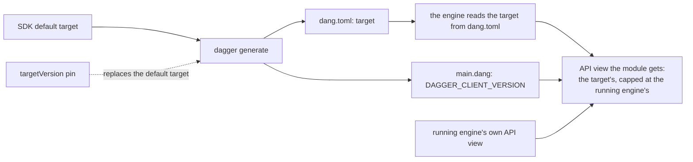
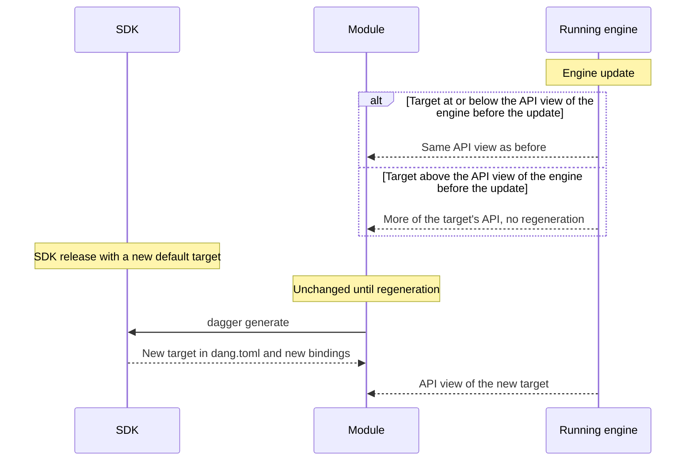

# SDK and engine versions

The target and the running engine decide which Dagger API a module gets. A third version, the floor, limits which engines the module works on.

- **Target**: the engine release a module is generated for
- **Floor**: the oldest engine a generated module works on
- **Running engine**: the engine that loads the module

An API view is the Dagger API as of one engine release. The running engine serves each module the API view of its target, capped at the running engine's own API view.

Each SDK release has a default target. A module on a generated entrypoint takes the default target unless its `targetVersion` setting pins another target. The target changes only at `dagger generate`.

## Target

`dagger generate` writes the target into two generated files of the module's entrypoint:

- `dang.toml`, as the `[imports.Dagger] dagger` key, which sets the module's API view and naming rules
- `main.dang`, as the `DAGGER_CLIENT_VERSION` it sets on the module process, which fixes the core API that process calls

```toml title="dang.toml"
dang = "2.1"
[imports]
[imports.Dagger]
dagger = "<target>"
```

The module commits these files. Nothing in them changes until the next `dagger generate`.



## Engine update

An engine update changes no generated file, and the module needs no regeneration. When the target is at or below the API view of the engine before the update, the module keeps the API view of its target. APIs that are new in the updated engine stay out of the module's reach. `dagger generate` on the updated engine keeps the target.

When the target is above the API view of the engine before the update, that engine capped the module at its own API view. The updated engine serves more of the target's API, with no regeneration.

The timeline below shows both cases, then an SDK release:



## Floor

The floor is the oldest engine a generated module works on. The running engine does not check the floor when it loads a module.

`dagger module init` and `dagger generate` stop on an engine older than the SDK supports, in the Java and PHP SDKs. The PHP SDK's limit equals its default target. These checks cover generation only.

## Move to a new target

A module on a generated entrypoint moves to a new target with an SDK update. The new SDK release's target gives the module the new APIs after regeneration.

:::warning
A `targetVersion` setting keeps the old target. Step 2 removes or updates that setting.
:::

1. Point the SDK's `source` in `dagger.toml` at the new SDK release.
1. If the module has a `targetVersion` setting, remove it or set it to the new release.
1. Run `dagger generate -y`.
1. Commit the generated files.

A Go-runtime module keeps its `engineVersion` across SDK updates.

## Pin the target

The `targetVersion` setting pins a module's target. Within the accepted range, a pin keeps the target across an SDK update, so the module's API does not change. [Per-SDK mechanisms](#per-sdk-mechanisms) lists which SDKs accept a pin and which values they accept.

1. Add `targetVersion` to the module's scope settings in `dagger.toml`:

   ```toml title="dagger.toml"
   [sdks.<sdk>.scopes."<module path>".settings]
   targetVersion = "<release>"
   ```

1. Run `dagger generate -y`.

An SDK update can still change generated files that do not depend on the target, so run `dagger generate -y` after each SDK update.

The accepted values belong to the SDK release. A later SDK release can refuse a pin that an earlier one accepted.

## Per-SDK mechanisms

Each row describes a module on a generated Dang entrypoint.

| SDK | `targetVersion` | Target file |
| --- | --- | --- |
| Go | Accepts a range that ends one release above the default target. Pinning that release needs a running engine of that release. Refused in a Go-runtime module. | `internal/dagger/entrypoint/dang.toml` |
| Python | Accepts a range that ends at the default target. | `sdk/entrypoint/dang.toml` |
| TypeScript | Accepts only the default target. | `entrypoint/dang.toml` |
| Java | Accepts only the default target. | `src/generated/dang/entrypoint/dang.toml` |
| PHP | No setting. To keep a target, stay on the SDK release whose default target it is. | `sdk/entrypoint/dang.toml` |
| Ruby | No setting. To keep a target, stay on the SDK release whose default target it is. | `sdk/entrypoint/dang.toml` |

A Go-runtime module, a Python module on the runtime the Python SDK publishes, and a TypeScript module created with `--legacy-runtime` write their target as `engineVersion` in `dagger-module.toml`. Dang and Elixir modules also declare their target as `engineVersion` in `dagger-module.toml`. The running engine serves an `engineVersion` the same capped API view as a `dang.toml` target.

## When versions don't match

### Target newer than the running engine

The running engine compares base versions only. The base version is the version without its prerelease suffix: `v1.0.0` for `v1.0.0-beta.29`. A module whose target is a later prerelease of the engine's base version loads without a warning, and the engine serves that module its own API view.

The running engine refuses a target with a later base version than its own, and a target below `v0.9.9`. For example, a `dang.toml` that declares `v1.0.1` stops an engine whose base version is below `v1.0.1`. The error names both versions:

```shell
dagger functions
```

```text
! load local module source: module "py1" entrypoint: .dagger/modules/py1/sdk/entrypoint/dang.toml: module requires dagger v1.0.1, but you have v1.0.0-beta.29
```

### Pin outside the accepted range

`dagger generate` stops before it writes anything. A Python pin below the range:

```text
! module "py1" pins targetVersion v1.0.0-beta.25, which is below v1.0.0-beta.26, the oldest release a targetVersion pin may name: set targetVersion in its dagger.toml settings to v1.0.0-beta.27, or remove it to generate for v1.0.0-beta.27
```

A Python pin above the range:

```text
! module "py1" pins targetVersion v1.0.0-beta.28, which is later than v1.0.0-beta.27, the engine release this Python SDK generates for: install the SDK release built for v1.0.0-beta.28, or set targetVersion in its dagger.toml settings to v1.0.0-beta.27, or remove it
```

An SDK that accepts only its default target stops on any other value:

```shell
dagger module init -y java --name j1 --target-version v1.0.0-beta.26
```

```text
! evaluating receiver: evaluating receiver: targetVersion "v1.0.0-beta.26" is not v1.0.0-beta.28, the only release this SDK generates for
```

### Pin on an SDK without the setting

The PHP and Ruby SDKs have no `--target-version` flag:

```shell
dagger module init -y ruby --name r1 --target-version v1.0.0-beta.26
```

```text
Error: unknown flag: --target-version
```

They ignore a `targetVersion` scope setting in `dagger.toml`. The setting does not change the generated target.
