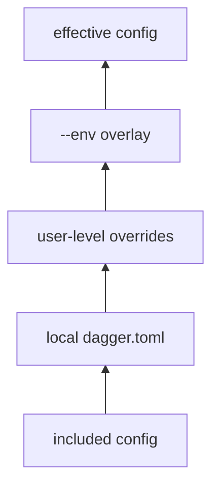

# Workspace Config Include

author: eunomie
created: 2026-08-12
status: implemented

PR: [#13882](https://github.com/dagger/dagger/pull/13882)

## Problem

Teams that run Dagger across many repositories copy the same `dagger.toml` into
each one: the same modules, tool versions, settings and envs. When a version
moves, every repository has to be edited.

Users asked for this on Discord:

- _vindico_: "I'm currently putting duplicated workspace config in a lot of repos."
- _chrisp6229_: asked to publish standard workspace configs per project type
  (go / node / terraform) and have downstream repos point at one.
- _shykes_: "As long as we don't go crazy with the config layering and other
  complications, it seems reasonable. Like a basic import feature in dagger.toml."

Before this change, `dagger.toml` was read from exactly one file. The only
layering was the user-level overlay and env overlays.

## Goals

- A workspace names another config file, by path or by git ref. That config is
  merged underneath its own.
- The current workspace wins every conflict. "Wins" means explicitly set,
  including an explicit `false` or an explicit empty list.
- A git include is pinned in `dagger.lock` like every other git ref. `dagger
  lock update` refreshes it. A path include has nothing to pin.
- The modules the included config installs are usable here, whether it names a
  remote ref or a directory beside itself.
- Read surfaces report the merged result.

## Non-goals

- **More than one include.** The `[[include]]` shape allows several entries, but
  resolving more than one is an error. `workspace.MaxIncludes` holds the limit.
- **Transitive includes.** An included config that includes again is an error.
- **A new lock operation.** The include uses the existing git lock entries.
- **Inherited SDK declarations.** An included config's `[sdks]` table does not
  cross the boundary.
- **Tombstones.** An inherited entry can be overridden but not deleted.
- **Write-through.** Every write edits the local `dagger.toml` only.

## Design

### Config surface

```toml
[[include]]
source = "github.com/acme/dagger-base@v1.2.0"

[modules.go.settings]
goVersion = "1.24"
```

`source` names a config file, not a workspace root, so one repository can publish
several base configs. It is either:

- a path: relative to the including config (`./base.toml`, `../shared/base.toml`,
  `common/base.toml`), or to the workspace root with a leading `/`;
- a git ref: `github.com/acme/dagger-base@v1.2.0`,
  `github.com/acme/dagger-base/common/base.toml@v1.2.0`,
  `https://host/repo.git#main:dagger/base.toml`.

`workspace.IsLocalRef` decides path versus ref, as for every other ref in a
workspace config. A dotted file name beside the config (`base.toml`) therefore
reads as a ref and is written `./base.toml`. A source with no file extension
names a directory and reads its `dagger.toml`.

The key is `include`. `import` was rejected as confusing next to module imports.
`blueprint` revived a retired `dagger.json` term.

### Layering



The include sits below every existing layer, so no existing precedence changes.
Reads return the effective config. Writes edit only the local file.

Include resolution runs in the workspace owner's client context. A frozen
workspace, or an overlay that edited the lock, resolves through the workspace's
own lock, as its modules do.

### Merge semantics

"Set" means present in the local file, read from the TOML document rather than
the Go zero value.

| Section / key | Rule |
| --- | --- |
| `include` | Never inherited. An `include` in the included config is an error. |
| `ignore` | Local replaces when set, including `[]`. |
| `defaults_from_dotenv`, `check-generated` | Local replaces when set, including `false`. |
| `modules.<name>` | Merged per field, so an entry may omit `source` and override one setting. |
| `modules.<name>.source` / `pin` | A local `source` replaces the inherited one, and its `pin` travels with it. A lone `pin` updates the inherited pin. |
| `modules.<name>.settings.<key>` | Merged key by key; local wins per key. |
| `modules.<name>.entrypoint` | Local replaces when set, including `false`. |
| `modules.<name>.{up,generate,check}.skip` | Local replaces when set, including `[]`. |
| `modules.<name>.legacy-default-path` | Never inherited: it describes the tree the config came from. |
| `sdks.<name>` | Never inherited: scopes are paths into the tree the config came from. A local declaration must name a provider installed in the same file, because SDK init, generation and provider settings read the local config. |
| `env.<name>` | Merged per env name. An env only the include defines is selectable. |
| `env.<name>.modules.<mod>` | Same rules as `modules.<name>`. |
| `ports.<host>` | Local replaces the mapping as a unit. |

### A module entry without a source

An entry may omit `source` so that it overrides a module the include provides.
The generated schema therefore no longer requires `source`, and the serializers
never write `source = ""`.

`workspace.ValidateEffectiveConfig` checks that every module has a source. It
runs where modules load, after the include, the user-level overrides and the
selected env overlay, because an env overlay can still supply the source. It runs
for every config, include or not. Reads do not run it, so a broken entry can
still be inspected and fixed.

### The included config's own modules

A local source in an included config names a directory beside that config.
Resolved as written, it would name something in the consuming workspace instead.
Sharing those modules is the point of the monorepo case:

```text
shared/tester/          the module
common/dagger.toml      [modules.tester] source = "../shared/tester"
project-a/dagger.toml   [[include]] source = "../common"
```

So each local source is re-addressed by how the config was reached:

- **Path include:** both configs are in one workspace. The path is rebased onto
  the including config's directory and always dot-prefixed, so it cannot read
  back as a ref.
- **Git include:** `modules/ci` becomes `<clone-ref>/modules/ci@<commit>`, the
  rewrite `-W <git ref>` already uses. The commit, not the symbolic version, keeps
  the config and its modules on one revision. The entry's own pin is cleared.

A repository root is a valid module: `source = "."` in a root config becomes
`<clone-ref>@<commit>`.

Some sources have no address here: built-in SDK runtime names (checked before
the path test, because `go@v1.2.3` contains a dot), absolute paths, and paths that
escape the tree. When the local config or a user-level override installs that
module, its source wins and the include's settings, env overlays and ports for
it are kept. When only an env installs it, from either config, the include's
base settings fill that env's overlay, but only keys nothing above them sets.
Otherwise the entry, the overlays that only configure it and the ports that
forward to it are dropped, with one warning per client naming them.

Classification uses `workspace.IsLocalRef` with an empty pin, the same call the
module loader makes. A pinned call would read `./ci` as git and let it through.

### Writes

Writes never touch the included config, and they say so when it would confuse:

- uninstalling a module only the include provides names the include;
- uninstalling a source-less override removes the override, and the inherited
  module returns;
- unsetting an inherited value names the include;
- an unrelated write leaves the `[[include]]` block, and its comments, in place.

`dagger workspace config include <source>` sets the single include. A failed
include does not block it: a client that does not load modules keeps the include
error, skips the user-level and env overlays, and returns the error only when
modules are demanded.

### Lockfile

The include resolves through the ordinary `git(url).ref` selectors, so it records
a standard `git-sha` entry. Later runs reuse the pin, and `dagger lock update`
refreshes it. A git include's own modules are pinned to the commit the config was
read at, so they add no lock entries.

### CLI

- `dagger workspace config` prints the effective config as a standalone
  snapshot. The `[[include]]` block becomes a `# included: <source>` comment, so
  the output cannot apply the include twice.
- `dagger workspace config include` reads the local value.
- Include resolution runs in a span named `including workspace config: <source>`.

## Alternatives considered

- **A general layer list (`extends`).** Rejected upstream: it needs an ordering
  model and diamond resolution before anyone asked for a second layer.
- **Merging each module entry wholesale.** Simpler, but a consumer would repeat
  the module's `source` to change one setting.
- **Erroring on, or dropping, an include's local modules.** Either leaves every
  monorepo project re-declaring the modules its shared config installs.
- **An inline include pin in `dagger.toml`.** The lock subsystem already models
  git lookups, and `dagger lock update` would not refresh a second pin.
- **Resolving the include in the CLI.** The CLI has no git or lock machinery, and
  module loading happens in the engine.

## Risks and limits

- **Network on load.** A git include adds a ref resolution and a tree fetch when
  a workspace binds, for every client, including config edits. A slow or broken
  remote delays a repair command until the fetch fails; the repair then succeeds.
- **Source-less entries.** A module entry with no source and nothing to supply it
  used to load with an empty reference. It now fails module loading, naming the
  module.
- **Inherited entries cannot be removed or excluded.** An include is trusted
  configuration shared inside a team or company: its modules, entrypoints,
  settings and action policies are inherited. A consumer neutralizes a module
  with `entrypoint = false` and `check`, `generate` and `up` skip patterns; the
  module still loads. A git include reuses the recorded pin while it is present,
  and `dagger lock update` refreshes it; a tag or a commit in `source` fixes the
  revision.
- **Symlinks.** An include path is contained lexically, like `Workspace.file` and
  local module sources. A symlink under the workspace that points outside it is
  followed.
- **An explicit clear reads as "not set".** The serializer omits zero values, so
  a local `ignore = []` does not appear in the effective view.
- **Address resolution degrades to "not installed".** It discards config errors
  when demand-loading, so an unreachable include reads as a missing module there.

## Related prior art

- `hack/designs/workspace.md`: `dagger.toml` shape, env overlays, entrypoints.
- `hack/designs/lockfile.md`: lookup entries and pinning.
- `future/synthetic-workspace.md`: `GitRef.asWorkspace`, the same "a git ref can
  denote a workspace" idea.
