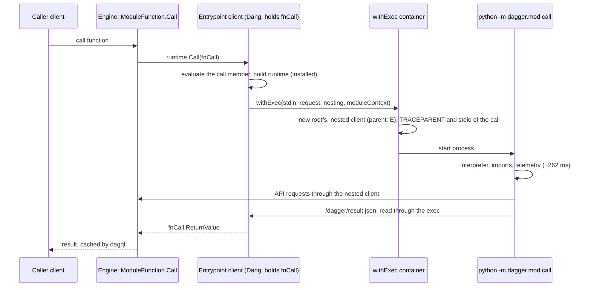
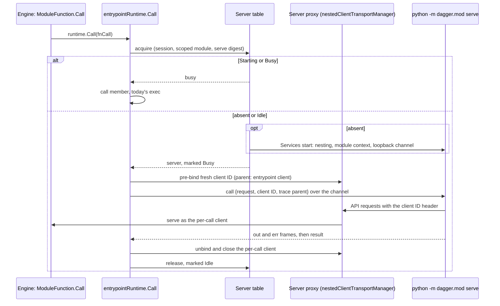
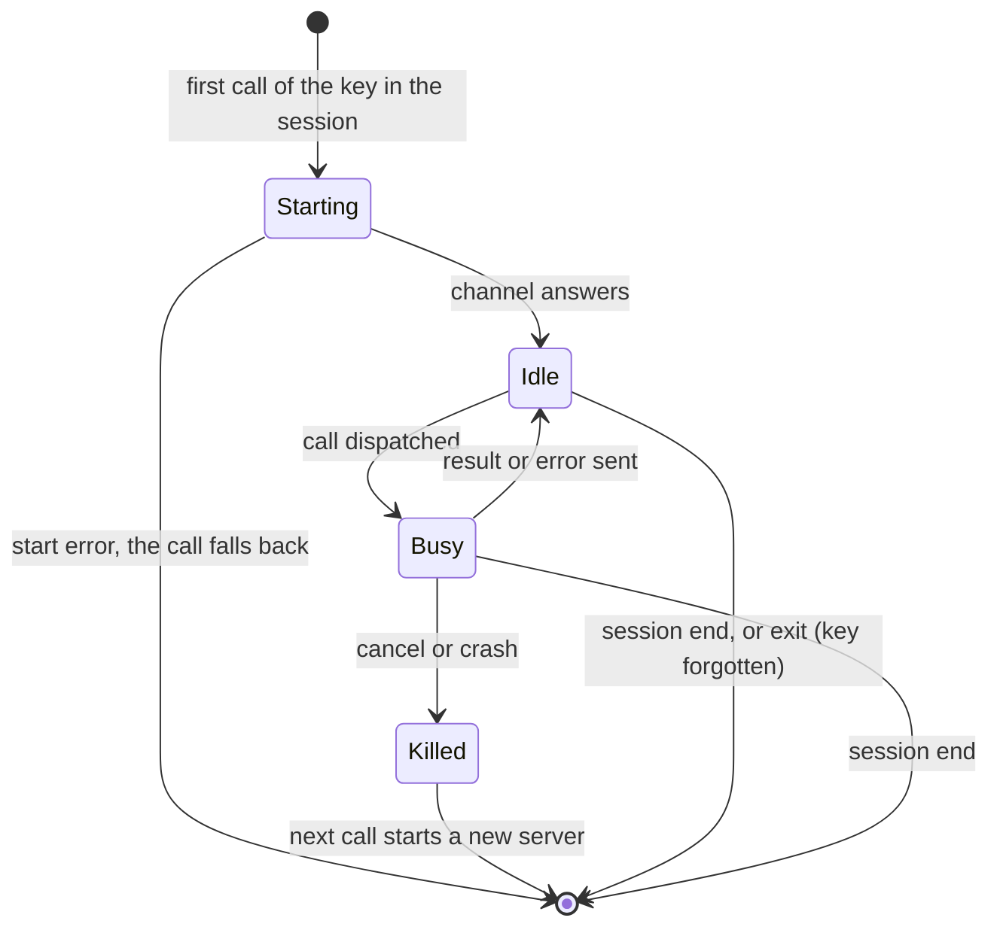

# Persistent Python module server

Scope: one warm Python process per session and module that serves function
calls in place of one new process per call. Base: dagger/dagger `9f15293b2d`
(merge of #15124) and dagger/python-sdk `34b23440`. A `path:line` reference
points into dagger/dagger; a `python-sdk:path:line` reference points into
dagger/python-sdk. Numbers come from the python-module-call-overhead findings,
measured after python-sdk#87 (stdlib bytecode, merge `b7388451`) on a warm
`v1.0.0-beta.25` engine with CPython 3.14.8.

## 1. Problem and budget

A warm Python module function call costs 374.1 ms (median function span, leaf
call). A Go module function call costs about 34 ms. A nested call, where one
Python module calls another, costs 1,417 ms and pays the Python cost twice.

| Part of a warm leaf call | ms | Source |
|---|---|---|
| Function span | 374.1 | findings, step 1 |
| Exec span of the module process | 308.7 | findings, step 1 |
| Outside the exec: entrypoint evaluation, request encoding, result read | ~65 | 374.1 − 308.7 |
| Exec setup outside the process | ~29 | 308.7 − 279.6 (process wall, step 2) |
| Interpreter start | 8.9 | step 2 |
| SDK imports, self time | 213 | step 2 |
| Telemetry setup | 40.0 | step 2 |
| Dispatch and result write | 10.8 | step 2 |

Step 2 timed subprocesses, not spans, so the last six rows add up to ~367 ms.
The item text's ~295 ms start and ~110 ms hand-off overlap; this design uses
the split above.

A warm process removes the interpreter start, the imports and the telemetry
setup: about 262 ms per call. Dispatching without an exec removes about 29 ms
more. Trimming imports (at most ~16 ms) is out of scope. The floor is the
~65 ms of entrypoint plumbing plus the dispatch. The Go entrypoint also starts
one exec per call (`.dagger/modules/go/internal/dagger/entrypoint/main.dang:170-196`),
so most of the 65 ms is likely Python-specific; this design leaves it alone.

A module server lives for one session, and `dagger call` opens a new session
per invocation, so a single call gains nothing. The gain comes from repeated
calls in one session: checks, `dagger shell`, agents, pipelines, and modules
that call a dependency more than once.

## 2. Today's call path

1. `ModuleFunction.Call` (`core/modfunc.go:1026`) builds the `FunctionCall`
   (`:1072`) and calls `runtime.Call` (`:1114`). dagql caches its result.
2. `entrypointRuntime.Call` (`core/sdk/dang/v2/entrypoint.go:124-228`) marks a
   module process call (`:136`). A Dang client holding the `FunctionCall`
   (`core/sdk/dang/shared/shared.go:56,67`) calls the `call` member.
3. The `call` member (`python-sdk:sdk/src/dagger/mod/_entrypoint.py:218-238`)
   runs `python -m dagger.mod call` on `PythonModuleBuild(...).installed`
   (`python-sdk:runtime/build.dang:67`), with the request on stdin.
4. The process (`python-sdk:sdk/src/dagger/mod/__main__.py:100-114`) uses the
   default session over a shared connection (`python-sdk:sdk/src/dagger/client/_session.py:229-287,470-479`).

What the exec binds per process, and so what blocks reuse:

- No function call: `withExec` passes a nil `FunctionCall`
  (`core/schema/container.go:1920`, documented at `:1842-1846`). The process's
  client has no call (`engine/server/session.go:4007-4019`).
- One nested client with a fresh ID (`core/container_exec.go:2388-2397`), whose
  parent is the entrypoint client. Registration needs the parent's held scope,
  a live parent and an unused ID (`engine/server/client_scope.go:94-151`). The
  parent decides where dependency loading shows (`session.go:3069-3076`) and
  which host the process reaches (`session.go:4237-4257`).
- One trace parent and one log target: the call's process span
  (`core/container_exec.go:2336-2340`, `engine/engineutil/executor_spec.go:1127-1136`),
  which also receives stdout and stderr since #15117 (`0e6fbb99a3`,
  `executor_spec.go:1034-1054`).
- One module context: the starting client's own copy of the module
  (`core/schema_module_candidates.go:78-89`).

The exec's proxy serves several clients by a client ID header (`executor_spec.go:1551-1599`),
but only clients it registers itself, under the exec's fixed parent (`:1609-1615`).
It serves every request with the exec's fixed parent and module context (`:1431`).

**Compile rerun after a source edit.** The stdlib compile exec in `base()`
(`python-sdk:runtime/build.dang:140-155`) runs on the base image alone, yet it
reruns once after a source edit. In code, the entrypoint client's call is a
module process call (`entrypoint.go:136`), so `withExecDynamicInputs`
(`core/schema/container.go:1847-1876`) adds the implementation-scoped module,
which carries the module's content digest (`:1865-1866`), as the internal
`moduleContext` argument of every exec that client starts (`:1861-1875`). It
does so with nesting on, the default from view `v1.0.0-0` (`core/schema/util.go:25`;
the client declares `engine.Version`, `shared.go:153`). So the execs of
`base()`, `dependencies()` and `install()` are keyed on the module source. A
module server needs this same identity. S1's first step confirms it with a
trace; this design ran none.

## 3. Options

The engine half has five parts; options 1 and 2 reuse all but part 5's kill.

1. **Server table.** It starts one server per key through Services, once,
   under its own lock, and holds the server's single binding until session
   end. A call never starts the service itself: a second start returns the
   running instance and ignores its IO (`core/services.go:1255-1282`), and the
   last detach stops it (`:912-956`). The table marks each key Starting or
   Busy, so the busy decision needs no message to the server.
2. **Channel.** The server listens on a loopback port in its own network
   namespace. The engine dials it there with `engineutil.RunInNetNS` on the
   service's container ID, as the port health check does (`core/service.go:910,1087`,
   `core/healthcheck.go:79-84`), but every ~5 ms, not 100 ms (`:23`), to keep
   the first call near today's cost. Stdout is no channel: a service's stdout
   is logged on its own span (`core/service.go:817-820,855-863`).
3. **Per-call client.** The dispatcher registers a fresh client ID under call
   N's entrypoint client. That needs the client's held scope
   (`client_scope.go:94-103`), which today only its own requests carry, so
   `WithNestedClientServer` must hand the dispatcher one. Host access comes
   either from the server's bootstrap attachables, which need the same parents
   and secret token (`client_scope.go:326-331`), or from the entrypoint
   client's inert ones (`hostFromParent`, `:274`). `hostFromParent` makes the
   client's telemetry readable (`:243-245`), so each per-call client keeps a
   telemetry store (`engine/server/session.go:769-775`).
4. **Proxy pre-binding.** `nestedClientTransportManager` gains pre-bound client
   IDs, each with its transport, parent and module context.
   `transportForRequest` looks there first, and the handler serves the entry's
   parent and module context in place of the exec's (`executor_spec.go:1426-1431,1505-1599`).
   The dispatcher binds the ID before the call, then unbinds it and closes the
   transport. The table reaches the manager through a new handle from
   `setupNestedClient` (`:1307-1452`). #15117 owns this file, so its
   owner must agree to the change before S1. `setupOTel` stays untouched.
5. **Output and stop.** The engine writes the call's output frames to the
   call's process span. A cancelled call kills the server with `Services.Stop`
   and `kill`, under `context.WithoutCancel`: `Stop` reads the session from its
   context and gives up when that context ends (`core/services.go:799-831`).
   Session teardown stops every server (`core/services.go:852`, `session.go:1348`).

**Wire protocol.** S1 and S3 implement exactly this.

1. The server listens on 127.0.0.1:8737 in its own network namespace. The
   `serve` container's default arguments are `["python", "-m", "dagger.mod",
   "serve"]`. The container exposes no port, so Services runs no health check.
   The server listens only after it imports the module and sets up telemetry.
   The engine dials every ~5 ms until a connect succeeds. A successful connect
   moves the key from Starting to Idle.
2. Each call uses one TCP connection. The engine connects, writes one call
   frame, and reads frames until a result frame or a failure frame. The server
   then closes the connection. The server accepts one connection at a time.
3. A frame is 1 ASCII byte of kind, a 4-byte big-endian payload length, and
   the payload.
   - `C`, engine to server: UTF-8 JSON `{"request": {...}, "clientID": "...",
     "traceparent": "00-..."}`. `request` has the keys and values of the JSON
     that `call` writes to stdin today: `receiverType`, `receiverValue`,
     `fnName`, `fnArgs`. The engine encodes it, so the bytes can differ from
     Dang's `JSON.encode`; the server parses it. `clientID` is the pre-bound
     client ID. `traceparent` is the call's process span.
   - `O` and `E`, server to engine: raw bytes of file descriptor 1 and 2, in
     chunks of any size.
   - `R`, server to engine: the result JSON, the bytes `call` writes to
     `/dagger/result.json` today.
   - `X`, server to engine: the call failed. The payload is a UTF-8 message.
     The log and traceback already went out as `E` frames. The engine fails
     the call as it fails a non-zero exit.
4. On every API request of a call, the server sends
   `X-Dagger-Client-Metadata: base64(JSON {"client_id": "<clientID>"})`. The
   pre-bound entry supplies the rest of the client metadata. The `serve`
   container keeps `DAGGER_CLIENT_VERSION` in its environment.
5. The call digest and cancellation are not on the wire. The SDK does not read
   `DAGGER_MODULE_CALL_DIGEST`, and the engine kills the server to cancel a
   call.

The options differ in the SDK loop and in what they isolate:

1. **Concurrent server.** One process runs calls concurrently as anyio tasks.
2. **Fork server.** A single-threaded parent imports once and forks a child per
   call, which sets up telemetry, runs the call and exits.
3. **Serial server.** One process runs one call at a time. A call that finds
   the key Starting or Busy runs `call` at once.

| | 1 Concurrent | 2 Fork | 3 Serial |
|---|---|---|---|
| Warm leaf call (estimate) | ~90 ms | ~95-135 ms | ~90 ms |
| Concurrent call, same module | ~90 ms | ~95-135 ms | 374 ms (exec) |
| Nested A→B, both warm | ~840 ms | ~880 ms | ~840 ms |
| Inner self-call A→A | ~90 ms | ~95-135 ms | 374 ms (exec) |
| First call in a session | ~today | ~today | ~today |
| Idle memory per module (unmeasured) | 60-100 MB | 60-100 MB parent | 60-100 MB |
| Production lines, engine + SDK (provisional) | 450-600+ + 350-450 | 450-600+ + 300-400 | 450-600 + 200-250 |

Options 1 and 2 also need per-call cancellation, which the "+" leaves unsized:
a service stop signals the whole process (`core/service.go:965-1005`), so one
call needs its own cancel message. Test lines come on top: ~250 for the engine
and 120-200 for the SDK. A warm call is 374 − 262 − 29 ms plus an unmeasured
~5 ms per-call cost. Option 2 adds a fork (2-5 ms) and a child telemetry setup
(0-40 ms). The nested estimate removes about 290 ms twice from 1,417 ms.

## 4. What each option must settle

**Isolation.** Today each call gets a fresh container from `installed`, and
secrets reach the process only through the API.

- 1 and 3: the rootfs, the mounted module source (`python-sdk:runtime/build.dang:89`),
  the environment and module globals persist across one server's calls. A
  secret plaintext kept in a global stays readable by a later caller in the
  session. The SDK restores `os.environ` and the working directory per call.
- 2: memory and globals end with each child; the filesystem stays shared.
- Go gives no shared state today: its entrypoint runs a new `dispatch` process
  per call (`.dagger/modules/go/internal/dagger/entrypoint/main.dang:191-192`).

**SDK session per call.** Generated and global client calls use the default
session over the shared connection (`_session.py:229-287,470-479`), and each
session memoizes dependency loads (`_session.py:407-430`).

- 3: at call start, the serve loop sets the JSON client-metadata header the
  proxy reads (`executor_spec.go:1558-1567`). At call end, it closes the default
  session, which drops the memo and the connection (`_session.py:380-386`), but
  keeps the `Session` object that user globals may hold.
- 1: the binding must live in a context variable per task.
- 2: each child binds its session after the fork.

**Concurrency, nested calls, cancellation.**

- 1: tasks share one event loop and sync functions run in worker threads
  (`python-sdk:sdk/src/dagger/mod/_utils.py:27`). A stuck sync function stops
  only when the process dies, with every call in it.
- 2: concurrent and nested calls get their own child. Killing only a
  cancelled child needs a per-call cancel message (section 3).
- 3: a one-at-a-time server deadlocks if a call waits for it while it waits
  for that call, as a self-call does. The table never waits: Starting or Busy
  sends the call to `call`. Cancelling kills the server; the next call starts
  a new one.

**Process identity and cache.**

- Key: session, implementation-scoped module, and the digest of the `serve`
  container. `ServiceKey` has no module field (`core/services.go:163-169`), so
  the table folds the module's digest into the service digest. Only `withExec`
  adds a module context (`core/schema/container.go:680`), so the table sets
  `Service.ModuleContext` (`core/service.go:62`) itself.
- A source edit changes the key, so it starts a new server by the rule that
  reruns the compile exec. dagql call caching above `runtime.Call` is
  unchanged.
- Loss: after a pruned result, a served default-cached or per-session call
  runs the function again where today the exec answers from cache
  (`entrypoint.go:198-209`). Never and TTL calls lose nothing (`:210-215`).

**Starting client.** The server's own client is a child of the client that
starts it (`core/service.go:840-852`), and requests without a pre-bound ID go
to it, so the serve loop makes none outside a call. The first call's
entrypoint client closes after the call (`shared.go:60`), so the starting
client must outlive the server; the session's main client is the candidate.
The service leases its starter's scope (`core/services.go:1293-1303`).

**Telemetry and stdout per call, after #15117.**

- The call message carries the call's process span, which the SDK makes the
  call's OTel context. The server's OTLP proxy posts spans as the server's
  starting client (`executor_spec.go:1022-1032,1062-1071`), and the engine
  routes them to that origin and its ancestors (`session.go:688-704`). The CLI's
  root store should get them (S4 checks); a nested caller's own store does not.
- 2 and 3: the SDK points file descriptors 1 and 2 at a pipe per call, which
  also captures subprocesses, and sends the output as frames. The engine
  writes them to the call's process span, the span #15117 chose.
- 1: only `sys.stdout` and `sys.stderr` can follow a context variable.
- Output outside any call lands on the server's span, under the first call.

**Fallback to today's exec.** An engine that does not know `serve` keeps
calling `call` (unverified on `v1.0.0-beta.25`), as with the optional
`prebuild` and `runtimeImage` members (`entrypoint.go:231-249,450-471`). A
Starting or Busy key, a failed start, or a request that never reached the
server (dial or send failed) sends that call to `call`. The table watches
`RunningService.Wait` (`core/service.go:1085`) and forgets a key whose server
exited, as Services drops it (`core/services.go:1189-1200`). A server that dies
during a call fails that call, as a failed exec does, with no retry.

## 5. Recommendation

Build the smallest prototype of option 3: one warm server per session and
module, opt-in through a `serve` entrypoint member, held by Services through
the server table. A Starting or Busy key sends the call to `call` at once.
Servers stop at session end. A cancelled call kills its server.

- It removes about 285 of the 340 ms between Python and Go for each
  sequential call, with the smallest SDK loop and exact stdout capture.
- Option 2 or 1 later reuses the hosting, routing and output parts, and adds
  concurrent dispatch and per-call cancellation.

What this leaves out, until S4 has numbers:

- Graceful cancellation, an idle timer, a memory cap, a sticky record of a
  failed start, and a setting that disables serving. Without the sticky
  record, a server that cannot start costs every call a start attempt.
- Span delivery to a nested caller's own store, which needs `setupOTel`
  (#15117's code) or spans sent over the channel.
- Concurrent calls and self-calls of one module, which keep today's cost,
  per-call filesystem and memory isolation, and reuse across sessions.
- The ~65 ms of entrypoint plumbing, which keeps a warm Python call above Go.

## 6. Decisions for Yves

1. **(a)** Which option should the prototype build? **Recommendation:** option
   3. It keeps most of the gain with the smallest SDK loop.
   - ( ) Option 1: concurrent server
   - ( ) Option 2: fork server
   - ( ) Option 3: serial server with busy fallback
2. **(b)** Should serving be opt-in per module or the default for every Python
   module? **Recommendation:** opt-in until S4, because shared state is new.
   - ( ) Opt-in per module: the SDK emits `serve` only when the module asks
   - ( ) Default: the SDK emits `serve` for every Python module
3. **(c)** Which isolation contract do served calls get? **Recommendation:**
   documented shared state; a fresh filesystem per call rules out options 1 and 3.
   - ( ) Fresh filesystem and process state per call, as today
   - ( ) Documented shared state within one session and module
   - ( ) Shared state, but one server per calling module, so callers never share
4. **(d)** Where does the server process live? **Recommendation:** Services,
   through the server table, as the MCP client does (`core/mcpclient.go:109-139`).
   - ( ) Services-backed process with a server table
   - ( ) New engine registry beside the entrypoint members
5. **(e)** Which idle and memory limits apply? **Recommendation:** session end
   only in the prototype; S4's RSS numbers set the rest.
   - ( ) Session end only
   - ( ) Session end, or 5 minutes idle
   - ( ) Session end, 5 minutes idle, and at most 8 servers per session

## 7. Prototype slices

Each slice waits for Yves's approval of this design. S1 also waits for the
#15117 owner's agreement on the proxy change. No slice touches
`core/schema/workspace_sdk_generator.go`. S1 includes the plan's S2.

**S1, dagger/dagger: the engine half.** 450-600 production lines and about
250 test lines, provisional.

1. Confirm the compile-rerun mechanism with one trace: the compile exec's
   `moduleContext` argument changes after a source edit.
2. Read an optional `serve` member, as `evalEntrypointMember` reads `prebuild`
   (`entrypoint.go:288-384`): a container whose default arguments start the server.
3. Build the five parts of section 3.
4. Test with a Go fixture server in `core/integration/testdata` that speaks
   the protocol, so S1 does not wait for S3.

**S3, dagger/python-sdk: the serve loop.** 200-250 production lines and
120-200 test lines, provisional. `python -m dagger.mod serve` imports once and
listens on the loopback port. Per call, it binds the session as in section 4,
sets the OTel context, points file descriptors 1 and 2 at framed pipes, and
restores `os.environ` and the working directory. `ClientSession` builds its
HTTP client with only auth, timeout and transport (`_session.py:87-98`), so S3
adds a header hook for the client-metadata header. `MAIN_TEMPLATE` gains the
`serve` member for opted-in modules, with released API only. First check: a
`v1.0.0-beta.25` engine loads such a module and still uses `call`.

**S4: measurement**, as in section 8.

Checks use one dedicated engine built from the branch (GC cap about 20 GB), at
most 2 runs per slice. S1: `go test ./core/sdk/dang/v2 ./engine/server
./engine/engineutil` on the new tests, then `engine-dev test --pkg ./core/integration` with
`--run='TestModule/(<new serve tests>|TestModuleEntrypoint(ProcessServesModule|StdoutLogs|CallCachePolicies|SpanTree)|TestModuleFunctionProcessHasNoModule)'`.
S3: `uv run pytest sdk/tests/mod`, then the e2e `runtime-call-check`.

## 8. Measurement plan

- Fixtures: the findings' Python leaf and nested modules with S3, and Go SDK v1.5.0 `e104d3ff`, on CPython 3.14.8.
- Warm runs: one warm-up call, then five fresh calls with unique receiver
  inputs, all in one session, for the leaf and the nested call.
- Single-call runs: the same five calls, one session each.
- Cache-hit control: one repeated input must hit the dagql cache, with no dispatch.
- Report: median function span, first call in a session, idle RSS of the
  server, 2 and 8 concurrent calls with their fallback count, a cancelled call
  then a normal one, a source edit (new server, one compile rerun), the
  per-call telemetry stores, and where the TUI shows the server's spans.
- Success, against 374.1 ms, 1,417 ms and Go's 34 ms: warm leaf median at
  most 120 ms, warm nested at most 950 ms, first call and single-call sessions
  at most 30 ms above today. At most 2 runs.

## 9. Unverified claims

- Numbers: the ~65 ms split, the ~29 ms exec setup, the per-call cost, option
  2's fork and child telemetry cost, the idle RSS, the Go fixture's call path.
- Engine: a scope for the entrypoint client outside its requests, children of
  a closed client, the per-call client's host access, and starting servers
  under the session's main client.
- `v1.0.0-beta.25` ignoring `serve`, and the compile rerun until S1's trace.
